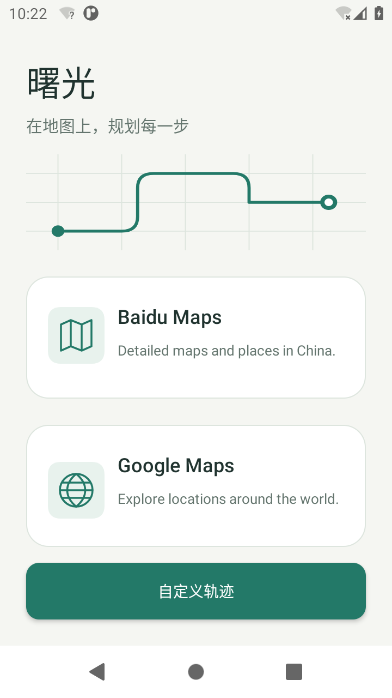
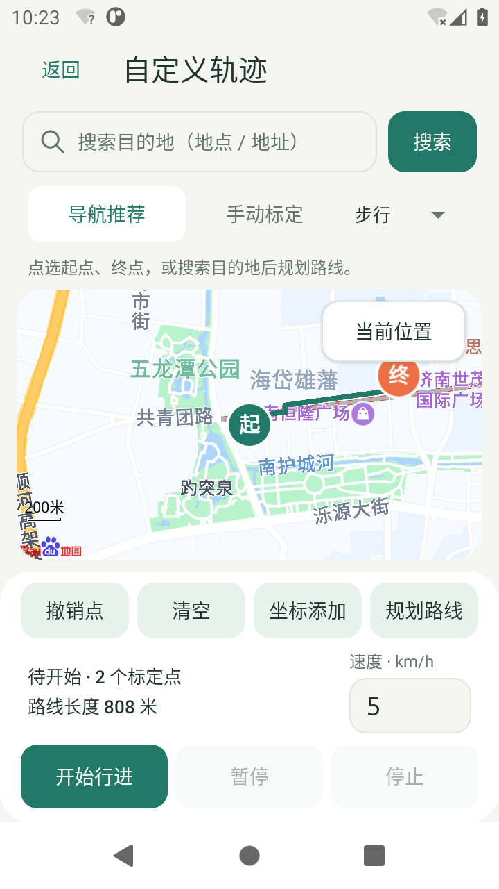
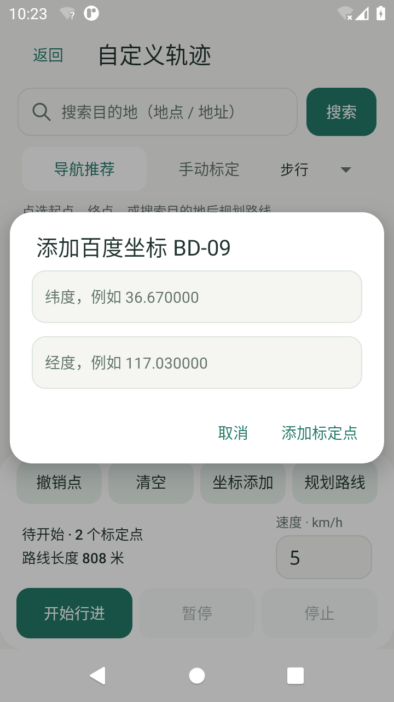

<div align="center">


# 曙光 · Shuguang

### 把路线画出来，让位置动起来。

**Android 位置模拟与自定义轨迹工具**<br>
导航推荐 · 自由标点 · 目的地搜索 · 可控移动

[](https://github.com/flower1201/shuguang/releases/latest)
[](#快速上手)
[](https://github.com/flower1201/shuguang/actions/workflows/build.yml)
[](LICENSE)
[](https://github.com/flower1201/shuguang/stargazers)

**[下载 v1.3 APK](https://github.com/flower1201/shuguang/releases/download/v1.3.0/shuguang-v1.3.apk)** · [更新说明](https://github.com/flower1201/shuguang/releases/tag/v1.3.0) · [English](README.en.md) · [反馈问题](https://github.com/flower1201/shuguang/issues)

</div>

---

## 一条路线，从想法到移动

搜一个目的地，选一条推荐路线；或者在地图上按顺序落下标定点。设置速度，点击开始——地图上的位置就会沿着你选定的轨迹前进。需要停一会儿，暂停；准备好了，继续。

曙光把 **选点、规划、移动和进度控制** 放进同一个原生 Android 界面，适合位置相关应用的开发联调、路线展示与个人轨迹实验。

## 看得见的 1.3

<div align="center">



</div>

<p align="center">暖白与松绿配色 · 原生地图画布 · 集中的轨迹操作面板</p>

## 两种轨迹，同一套控制

| 模式 | 怎么设置 | 怎么移动 |
| --- | --- | --- |
| **导航推荐** | 选择起点和终点，使用步行 / 驾车 / 骑行规划 | 沿百度地图返回的第一条推荐路线及其道路坐标前进 |
| **手动标定** | 在地图上依次点选，或直接输入 BD-09 坐标 | 按标定点顺序，逐段沿直线前进 |

### 该有的控制，都在手边

- **目的地搜索**：按地点名称或地址查找，显示名称与地址；支持城市选择和结果翻页。
- **当前位置**：把地图移到设备提供的位置，可设为起点或加入标定点；系统返回模拟位置时会明确提示。
- **速度可调**：`0.1–300 km/h`，默认 `5 km/h`。
- **暂停 / 继续 / 停止**：查看已行进距离、总距离和完成百分比。
- **编辑与保存**：撤销、清空、坐标输入；保存路线草稿，返回编辑页可以接着操作。
- **后台行进**：离开轨迹编辑页仍可继续移动，直至停止、到达终点或进程被系统终止。
- **地图与历史**：保留百度 / Google 地图入口、位置历史、坐标操作和悬浮方向控制。

导航请求失败时会显示原因，**不会用直线替代道路路线**。轨迹编辑与推荐路线使用百度地图；地图服务可用性取决于网络、Key 授权和设备环境。

## 快速上手

1. [下载并安装 v1.3 APK](https://github.com/flower1201/shuguang/releases/download/v1.3.0/shuguang-v1.3.apk)。最低 Android 8.1（API 27）。
2. 打开系统 **开发者选项 → 选择模拟位置信息应用 → 曙光**。
3. 允许位置权限；需要获取当前位置时开启系统定位。
4. 点击 **自定义轨迹**，选择导航推荐或手动标定。
5. 设置路线和速度，点击 **开始行进**。

<details>
<summary><strong>安装、地图与定位常见问题</strong></summary>

- **能覆盖旧版吗？** 同包名且签名一致时可以覆盖安装。签名冲突时，先备份需要保留的数据，再卸载旧包。
- **定位按钮为什么没有回到真实位置？** 它读取系统提供的位置；模拟定位正在工作时，系统可能返回模拟位置，界面会标明。
- **地图或搜索没有结果？** 检查网络、定位权限、地图 Key 的包名 / SHA1 绑定，以及相关服务权限。
- **导航规划失败怎么办？** 检查起终点、网络与 Key 授权，或切换手动标定创建直线轨迹。
- **所有应用都能使用模拟位置吗？** 不保证。不同系统与接收位置的应用可能限制、忽略或识别模拟位置；本项目不提供绕过检测的承诺。
- **后台一定持续运行吗？** 不保证。省电策略和系统进程回收可能中断运行，进程终止后不会自动恢复移动。

</details>

## 给开发者：能看懂，也能重建

本仓库是 **apktool 可重建工程**；新增轨迹模块同时提供 **Java 源码与生成的 smali**。它不是完整的 Android Studio / Gradle 源码工程。

| 路径 | 内容 |
| --- | --- |
| [`route-src/java/`](route-src/java/) | 轨迹几何、播放控制、导航规划、地点搜索与原生轨迹界面 |
| [`apktool/`](apktool/) | 可重建的 smali、资源与清单 |
| [`scripts/build.ps1`](scripts/build.ps1) | 编译轨迹扩展、重建 APK 与签名的 PowerShell 入口 |
| [`scripts/prepare-app-icon.py`](scripts/prepare-app-icon.py) | 从图标原图导出 Android 各密度资源 |
| [`DESIGN.md`](DESIGN.md) | 颜色、字体、控件及布局规范 |
| [GitHub Actions](https://github.com/flower1201/shuguang/actions) | 公开源码构建记录与构建产物 |

### 本地构建

准备 JDK 17+、Android SDK（API 27+ 平台与 D8）、apktool 3.0.2 和 uber-apk-signer 1.3.0，然后执行：

```powershell
$env:ANDROID_HOME = '你的 Android SDK 目录'
$env:APKTOOL_BAT = '你的 apktool.bat 路径'
$env:UBER_APK_SIGNER_JAR = '你的 uber-apk-signer.jar 路径'
./scripts/build.ps1
```

地图配置可写入被 Git 忽略的 `.tools/local-map-keys.json`：

```json
{
  "com.baidu.lbsapi.API_KEY": "YOUR_BAIDU_ANDROID_KEY",
  "com.google.android.geo.API_KEY": "YOUR_GOOGLE_MAPS_KEY"
}
```

构建脚本只把本地 Key 写入临时构建副本，公开源码保留占位符。请为自己的包名和签名配置服务权限。完整说明见 [轨迹模块文档](route-src/README.md) 与 [安全说明](SECURITY.md)。

### 版本与校验

| 项目 | v1.3 |
| --- | --- |
| Version name / code | `1.3` / `35` |
| 包名 | `com.mm.app.ybwwlkj` |
| 发布文件 | `shuguang-v1.3.apk` |
| 签名 | Android Debug，APK Signature Scheme v2 / v3 |
| SHA-256 | `a69a3c9d99b7c61865d22fb81f2fdcea5ad508cd8387a03d0abd172222dd4b5f` |

发布 APK 与 Actions 构建产物是不同文件。Actions 使用占位地图 Key 和其构建环境生成的 Debug 签名，不能保证与 Release 包直接覆盖安装。广告配置使用官方测试 App ID。

开发过程中在 Android 11 模拟器中完成过手动轨迹、暂停 / 继续、到达终点及后台行进验证，并成功获取百度步行推荐路线；1.3 已完成构建、签名和模拟器安装。**尚未完成各品牌真机与所有功能场景的完整回归。**

## 一起把它做得更好

欢迎提交 [Issue](https://github.com/flower1201/shuguang/issues) 或 Pull Request。反馈时附上 Android 版本、设备型号和复现步骤，会更容易定位问题。[参与贡献 →](CONTRIBUTING.md)

如果曙光帮你省下了位置联调的时间，欢迎点个 **Star**，让更多需要它的人发现这个项目。

## License

项目代码采用 [MIT License](LICENSE)。集成的地图、广告等第三方 SDK 仍受各自许可和服务条款约束。
